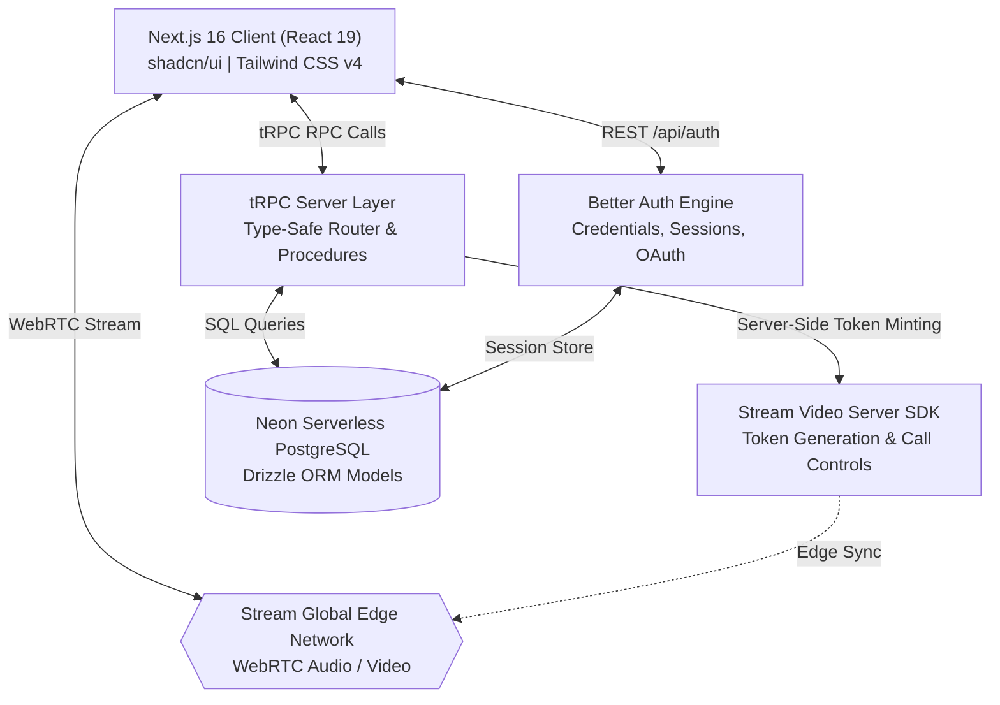
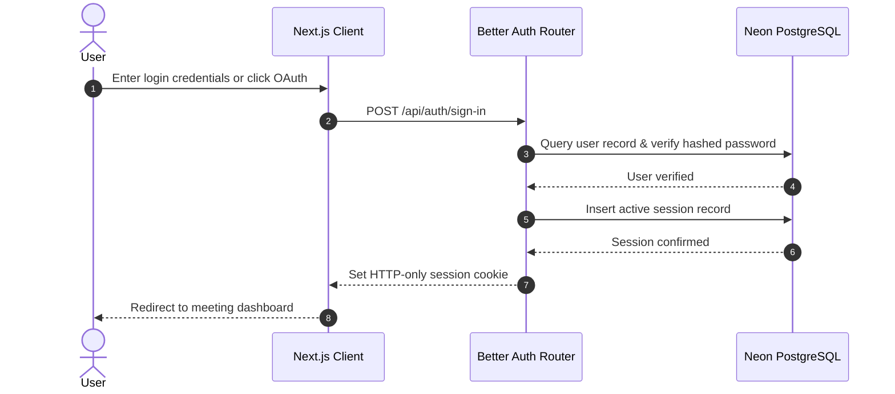
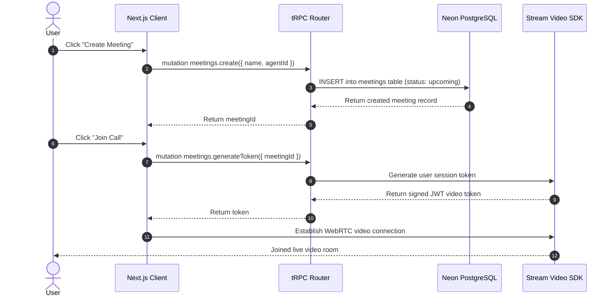

# Meridian AI

> Full-stack SaaS platform for video conferencing and custom AI agents, built with Next.js 16 App Router, React 19, tRPC, Drizzle ORM, Neon Serverless PostgreSQL, Stream Video SDK, and Better Auth.

[](https://nextjs.org/)
[](https://react.dev/)
[](https://www.typescriptlang.org/)
[](https://trpc.io/)
[](https://tailwindcss.com/)
[](https://orm.drizzle.team/)
[](https://neon.tech/)
[](https://getstream.io/video/)
[](LICENSE)

---

## Table of Contents

- [Problem & Motivation](#problem--motivation)
- [System Architecture](#system-architecture)
- [Key Features](#key-features)
- [Workflows & Sequence Flows](#workflows--sequence-flows)
  - [Authentication Lifecycle](#authentication-lifecycle)
  - [Meeting Creation & WebRTC Session Token](#meeting-creation--webrtc-session-token)
- [Tech Stack](#tech-stack)
- [Project Structure](#project-structure)
- [Getting Started](#getting-started)
  - [Prerequisites](#prerequisites)
  - [Installation & Local Setup](#installation--local-setup)
- [Environment Variables](#environment-variables)
- [tRPC API Procedures](#trpc-api-procedures)
- [Screenshots & Visuals](#screenshots--visuals)
- [Roadmap](#roadmap)
- [Author](#author)
- [License](#license)

---

## Problem & Motivation

Modern collaboration platforms often treat video conferencing and AI workflows as separate silos. Users have meetings on one tool, then manually copy transcripts or notes into another tool to perform analysis.

**Meridian AI** bridges this gap by embedding configurable AI agents directly into the meeting lifecycle. Built as an end-to-end type-safe SaaS application, it provides:
1. **Low-latency real-time video** backed by the global WebRTC infrastructure of the Stream Video SDK.
2. **Configurable AI agents** with bespoke instructions and persona profiles.
3. **End-to-end type safety** across client components, tRPC API routers, and PostgreSQL relational schemas without manual API contract synchronization.

---

## System Architecture



---

## Key Features

- **Authentication & Sessions**: Built with `better-auth`, supporting email/password and social OAuth (GitHub and Google) with secure session cookie handling.
- **Custom AI Agents**: Create, edit, and manage custom AI agents with distinct instructions, roles, and programmatic avatars generated via DiceBear.
- **Real-Time Video Conferencing**: High-definition, low-latency video and audio rooms powered by the Stream Video React SDK.
- **Meeting Management**: Schedule meetings, track status transitions (`upcoming`, `active`, `completed`), and record meeting metadata.
- **End-to-End Type Safety**: 100% type-safe data flow across 11+ tRPC procedures, eliminating runtime serialization bugs between backend and client.
- **Modern UI / UX**: Built on Tailwind CSS v4, Radix UI primitives, Lucide icons, and responsive data visualization via Recharts.

---

## Workflows & Sequence Flows

### Authentication Lifecycle



### Meeting Creation & WebRTC Session Token



---

## Tech Stack

| Domain | Technology | Version | Description |
|---|---|:---:|---|
| **Framework** | Next.js (App Router) | `16.2.6` | React server/client architecture and API route runtime |
| **Frontend UI** | React | `19.2.4` | Component layer with modern hooks and actions |
| **Language** | TypeScript | `^5.0` | Strict static typing across full codebase |
| **Styling** | Tailwind CSS | `v4.0` | Modern CSS styling with PostCSS integration |
| **Components** | Radix UI / shadcn/ui | Latest | Accessible, unstyled primitives and custom components |
| **API Layer** | tRPC | `^11.17` | End-to-end typesafe client-server communication |
| **Client State** | TanStack React Query | `^5.100` | Asynchronous query caching and mutation lifecycle |
| **Database** | Neon Serverless PostgreSQL | `@neondatabase/serverless` | Cloud-native serverless PostgreSQL instance |
| **ORM** | Drizzle ORM & Drizzle Kit | `^0.45` | TypeScript ORM, schema declarations, and migrations |
| **Authentication** | Better Auth | `^1.6` | Modern authentication framework for Next.js |
| **Video Engine** | Stream Video SDK | `^1.37` (React) / `^0.7` (Node) | WebRTC video calling and media infrastructure |
| **Validation** | Zod | `^4.4` | Strict schema validation for form and API inputs |

---

## Project Structure

```text
meridian-ai/
├── src/
│   ├── app/                   # Next.js App Router (pages and API handlers)
│   │   ├── (dashboard)/       # Authenticated dashboard views (agents, meetings)
│   │   ├── api/auth/          # Better Auth route handlers (/api/auth/[...all])
│   │   └── api/trpc/          # tRPC HTTP handler (/api/trpc/[trpc])
│   ├── components/            # Shared UI components (shadcn/ui, modals, navigation)
│   ├── db/                    # Database setup
│   │   ├── index.ts           # Drizzle instance initialized with Neon connection
│   │   └── schema.ts          # Relational schema (users, sessions, agents, meetings)
│   ├── hooks/                 # Reusable client hooks
│   ├── lib/                   # Utility helpers and Stream client initializers
│   ├── modules/               # Feature domain modules
│   │   ├── agents/            # Agent management views, forms, and tRPC procedures
│   │   ├── auth/              # Authentication forms and session utilities
│   │   ├── call/              # Active Stream Video calling room components
│   │   ├── dashboard/         # Dashboard layout, metrics, and navigation
│   │   └── meetings/          # Meeting scheduling, token generation, and lists
│   └── trpc/                  # tRPC setup
│       ├── init.ts            # Context, protected procedure middlewares
│       └── routers/           # Root appRouter combining feature procedure routers
├── drizzle.config.ts          # Drizzle Kit migration configuration
├── next.config.ts             # Next.js configuration
├── package.json               # Project dependencies and run scripts
├── tsconfig.json              # TypeScript compiler configuration
├── .env.example               # Environment variables template
└── LICENSE                    # MIT License
```

---

## Getting Started

### Prerequisites

- [Node.js (v18+)](https://nodejs.org/) installed.
- A free [Neon](https://neon.tech/) PostgreSQL database account.
- A free [Stream](https://getstream.io/) account for Video API keys.
- Git installed.

---

### Installation & Local Setup

1. Clone the repository and navigate to the project directory:
   ```bash
   git clone https://github.com/Rohit-hub-coder/meridian-ai.git
   cd meridian-ai
   ```

2. Install all dependencies:
   ```bash
   npm install
   ```

3. Configure your local environment file:
   ```powershell
   # Windows PowerShell
   Copy-Item .env.example .env.local

   # Linux / macOS
   cp .env.example .env.local
   ```
   *Fill in your database URL and Stream credentials in `.env.local`.*

4. Push the Drizzle database schema to Neon:
   ```bash
   npm run db:push
   ```

5. Start the Next.js development server:
   ```bash
   npm run dev
   ```
   Open [http://localhost:3000](http://localhost:3000) in your browser.

6. *(Optional)* Launch Drizzle Studio to inspect and edit database records visually:
   ```bash
   npm run db:studio
   ```

---

## Environment Variables

Configured in `.env.local` (reference `.env.example`):

| Variable | Required | Description |
|---|:---:|---|
| `DATABASE_URL` | **Yes** | Neon PostgreSQL connection string (`postgres://...`) |
| `BETTER_AUTH_SECRET` | **Yes** | Secret encryption key for user sessions |
| `BETTER_AUTH_URL` | **Yes** | Base application URL (e.g., `http://localhost:3000`) |
| `NEXT_PUBLIC_STREAM_VIDEO_API_KEY` | **Yes** | Public Stream Video API key exposed to the client |
| `STREAM_VIDEO_SECRET_KEY` | **Yes** | Server-side Stream Video secret key for token minting |
| `GITHUB_CLIENT_ID` | Optional | GitHub OAuth client ID for social authentication |
| `GITHUB_CLIENT_SECRET` | Optional | GitHub OAuth client secret |
| `GOOGLE_CLIENT_ID` | Optional | Google OAuth client ID for social authentication |
| `GOOGLE_CLIENT_SECRET` | Optional | Google OAuth client secret |

---

## tRPC API Procedures

All backend endpoints are strongly typed and accessed via `trpc.<router>.<procedure>`:

| Router | Procedure | Type | Access | Description |
|---|---|:---:|:---:|---|
| `agents` | `getMany` | Query | Protected | Retrieve all agents belonging to the authenticated user |
| `agents` | `getOne` | Query | Protected | Fetch specific agent details by ID |
| `agents` | `create` | Mutation | Protected | Create a new AI agent with custom instructions and avatar |
| `agents` | `update` | Mutation | Protected | Update existing agent name or instructions |
| `agents` | `remove` | Mutation | Protected | Delete an agent |
| `meetings` | `getMany` | Query | Protected | List upcoming and past meetings with pagination |
| `meetings` | `getOne` | Query | Protected | Retrieve specific meeting metadata and attached agent info |
| `meetings` | `create` | Mutation | Protected | Schedule a new meeting and attach target agent |
| `meetings` | `update` | Mutation | Protected | Update meeting time, name, or metadata |
| `meetings` | `remove` | Mutation | Protected | Delete or cancel a scheduled meeting |
| `meetings` | `generateToken` | Mutation | Protected | Mint a secure Stream Video WebRTC session token |

---

## Screenshots & Visuals

*Place preview assets under `docs/`:*

- `docs/dashboard-home.png`: Main dashboard showing upcoming meetings and active agents.
- `docs/video-room.png`: Active WebRTC meeting room interface powered by Stream Video SDK.
- `docs/agent-builder.png`: AI agent configuration modal with instructions and avatar selector.
- `docs/meeting-scheduler.png`: Meeting creation form with agent assignment.

---

## Roadmap

- [ ] **Real-Time Transcription Pipeline**: Stream live WebRTC audio directly to speech-to-text models.
- [ ] **Autonomous Meeting Agent**: In-call bot that speaks and answers questions directly inside the video room.
- [ ] **Automated Action Items**: Post-meeting generation of action items and executive summaries sent via email.
- [ ] **Calendar Integrations**: Two-way sync with Google Calendar and Microsoft Outlook.

---

## Author

**Rohit Kumar**  
Software Engineering Undergrad @ Delhi Technological University (DTU)  
- GitHub: [@Rohit-hub-coder](https://github.com/Rohit-hub-coder)  
- LinkedIn: [Rohit Kumar](https://linkedin.com/in/rohit-kumar-dtu)  
- Email: [dhimanrohit1003@gmail.com](mailto:dhimanrohit1003@gmail.com)

---

## License

This project is licensed under the [MIT License](LICENSE).
